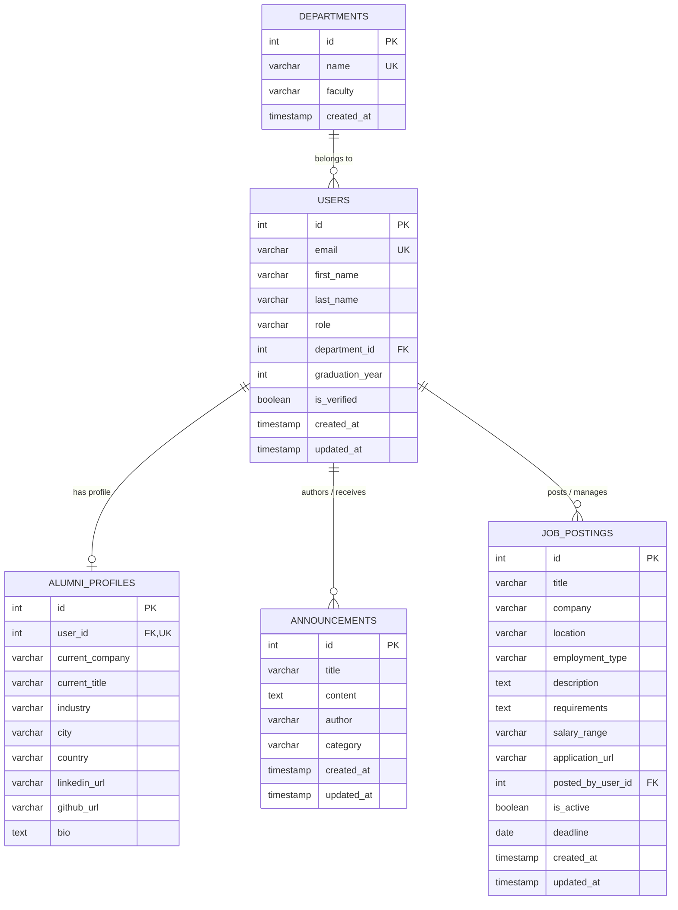

# Alumni Tracking System

[](https://nodejs.org/)
[](https://expressjs.com/)
[](https://www.postgresql.org/)
[](#-docker-setup--the-forgetting-test)
[](ddd.md)
[](#-mvc-architecture-overview)
[](http://localhost:3000/api/swagger)
[](https://github.com/ceydasenemyigit/alumni)

---

## 📌 About the Project

The **Alumni Tracking System** is a web-based platform designed to maintain academic and professional records of university graduates, support networking between alumni, broadcast events and announcements, and enhance communication with university management. Developed for the Web Programming course at Istanbul University, the project strictly adheres to the **Model-View-Controller (MVC)** architectural pattern while exposing both server-rendered web views and RESTful JSON APIs, accompanied by robust containerization and database persistence.

---

## 🏛️ MVC Architecture Overview

The application is structured following the **Model-View-Controller (MVC)** software design pattern to ensure high separation of concerns, testability, and clean code maintainability across its core modules (**Users** and **Announcements**):

```
                                 +-------------------+
                                 |   Client Browser  |
                                 |   / HTTP Client   |
                                 +---------+---------+
                                           |
                    +----------------------+----------------------+
                    |                                             |
          (HTML View Requests)                          (JSON API Requests)
                    v                                             v
+---------------------------------------+     +---------------------------------------+
|              CONTROLLERS              |     |            API CONTROLLERS            |
|  - UserController (views/users)       |     |  - ApiUserController (/api/users)     |
|  - AnnouncementController             |     |  - ApiAnnouncementController          |
|    (views/announcements)              |     |    (/api/announcements)               |
+-------------------+-------------------+     +-------------------+-------------------+
                    |                                             |
                    |           +---------------------+           |
                    +---------->|       MODELS        |<----------+
                    |           |  - userModel.js     |           |
                    |           |  - announcementModel|           |
                    |           +---------------------+           |
                    v                                             v
+---------------------------------------+     +---------------------------------------+
|               EJS VIEWS               |     |            JSON RESPONSES             |
|   Server-Side Rendered HTML Pages     |     |   Standardized REST JSON Payloads     |
|   (index, show, new, edit templates)  |     |   (200 OK, 201 Created, 400, 404)     |
+---------------------------------------+     +---------------------------------------+
```

### 1. Model Layer (`src/models/`)
- Encapsulates domain data logic, validation, SQL queries, and relational associations with seamless database / in-memory fallback:
  - **`userModel.js`**: Stores student, alumni, and admin profiles (`id`, `email`, `first_name`, `last_name`, `role`, `department_name`, `graduation_year`, `is_verified`). Implements CRUD and relational methods (`getDepartment`, `getProfile`, `getJobPostings`, `findWithRelations`).
  - **`departmentModel.js`**: Manages university faculties and departments. Defines **1:N** relation with users (`getUsers(departmentId)`).
  - **`alumniProfileModel.js`**: Manages extended graduate career details (`current_company`, `current_title`, `industry`, `linkedin_url`, `bio`). Defines **1:1** relation with User (`getUser(userId)`).
  - **`announcementModel.js`**: Stores university and community notices with categories (`Event`, `Career`, `Academic`, `General`). Provides full CRUD helpers (`getAll`, `getById`, `create`, `update`, `delete`).
  - **`jobPostingModel.js`**: Manages job vacancies and internship listings. Defines **N:1** relation with User (`getPoster(jobId)`, `findByUserId(userId)`).
  - **`index.js`**: Central registry exporting all models and defining formal association metadata (`relations`).

### 2. View Layer (`views/`)
- Server-side rendered HTML interfaces powered by the **EJS (Embedded JavaScript)** template engine.
- Organized into modular subdirectories:
  - **`views/users/`**: `index.ejs` (directory list), `new.ejs` (creation form), `show.ejs` (profile details), `edit.ejs` (edit form).
  - **`views/announcements/`**: `index.ejs` (notices list with category filters), `new.ejs` (publish form), `show.ejs` (announcement details), `edit.ejs` (edit form).
  - **`views/partials/`**: `header.ejs` (responsive dark-themed navigation, badges) & `footer.ejs`.
  - **`views/error.ejs`**: Unified user-friendly error display template.

### 3. Controller Layer (`src/controllers/`)
- Separated into dual controllers for each domain resource:
  - **Web Controllers (`userController.js`, `announcementController.js`)**: Handle browser navigation, parse web forms, invoke models, and render EJS templates.
  - **API Controllers (`apiUserController.js`, `apiAnnouncementController.js`)**: Handle RESTful JSON/Form requests, validate input, call model methods, and return standard JSON responses with HTTP status codes (200, 201, 400, 404).
  - **`healthController.js`**: Provides real-time system diagnostics and health status metrics.

---

## 📊 Data Design Documentation (DDD)

> 📘 Full detailed documentation, data dictionary, normalization proofs, and SQL scripts are located in [**`ddd.md`**](ddd.md).

### Entity-Relationship Diagram (ERD)



### Database Schema Summary

| Table | Primary Key | Foreign Keys | Key Constraints & Purpose |
|---|---|---|---|
| **`departments`** | `id` (SERIAL) | — | `name UNIQUE` (Departments & Faculties) |
| **`users`** | `id` (SERIAL) | `department_id -> departments(id)` | `email UNIQUE`, `role IN ('STUDENT','ALUMNI','ADMIN')` |
| **`alumni_profiles`** | `id` (SERIAL) | `user_id -> users(id) ON DELETE CASCADE` | `user_id UNIQUE` (1:1 Graduate Career Profile) |
| **`announcements`** | `id` (SERIAL) | — | `category IN ('Event','Career','Academic','General')` |
| **`job_postings`** | `id` (SERIAL) | `posted_by_user_id -> users(id) ON DELETE SET NULL` | `employment_type IN ('Full-Time','Part-Time','Contract','Internship','Remote')` (Career Board) |

---

## 🧪 Docker Setup & The Forgetting Test

### 1. What is "The Forgetting Test"?

In containerized architectures, container writable filesystems are **ephemeral** by default. If a container is terminated and removed via `docker compose down`, any data written to the container is permanently wiped out. The container **"forgets"** the record!

To make the database **"remember"**, a persistent storage mechanism — a **Docker Named Volume** (`postgres_data`) — is mapped to `/var/lib/postgresql/data`.

**"The Forgetting Test"** empirically verifies that data survives container teardown and re-creation:
1. Start services with `docker compose up -d`.
2. Insert a new record into the database.
3. Bring down all containers and networks with `docker compose down`.
4. Spin up fresh containers with `docker compose up -d`.
5. Check whether the record still exists:
   - **Without Named Volume**: Record is lost (system forgot).
   - **With Named Volume**: Record is preserved (system remembered).

### 2. Manual Reproduction Steps

```bash
# Step 1: Start the Docker stack
docker compose up -d

# Step 2: Insert a record into PostgreSQL
docker exec -i alumni_postgres psql -U alumni_user -d alumni_db -c \
  "INSERT INTO announcements (title, content, author, category) VALUES ('Homecoming 2026', 'Forgetting Test Record', 'Alumni Office', 'Event');"

# Step 3: Verify the record exists
docker exec -i alumni_postgres psql -U alumni_user -d alumni_db -c \
  "SELECT id, title, category, created_at FROM announcements WHERE title = 'Homecoming 2026';"

# Step 4: Tear down containers and networks
docker compose down

# Step 5: Re-launch fresh containers
docker compose up -d

# Step 6: Verify the record survived (The Forgetting Test Passed!)
docker exec -i alumni_postgres psql -U alumni_user -d alumni_db -c \
  "SELECT id, title, author, category, created_at FROM announcements WHERE title = 'Homecoming 2026';"
```

### 3. Automated Forgetting Test Scripts

You can execute the automated test with a single command:
- **Linux/macOS (Bash):**
  ```bash
  chmod +x scripts/forgetting_test.sh
  ./scripts/forgetting_test.sh
  ```
- **Windows (PowerShell):**
  ```powershell
  powershell -ExecutionPolicy Bypass -File scripts/forgetting_test.ps1
  ```

---

## 📂 Directories, Folders & Files Structure

```text
alumni/
├── docker-compose.yml                # Docker Compose orchestration (App + PostgreSQL)
├── docker_compose.yml                # Alternative naming compatibility
├── Dockerfile                        # Multi-stage lightweight Node.js 20 container image
├── .dockerignore                     # Excluded container build files
├── .env.example                      # Template for all environment variables
├── ddd.md                            # Comprehensive Data Design Document (DDD)
├── index.js                          # Server entrypoint (listens on PORT)
├── package.json                      # Project dependencies, scripts, and metadata
├── package-lock.json                 # Dependency tree lockfile
├── swagger.json                      # OpenAPI 3.0.3 specification for Swagger UI
├── test.js                           # Automated test suite (30 unit/integration tests)
├── .gitignore                        # Git exclusion configuration
├── README.md                         # Project documentation
│
├── db/                               # DATABASE SCHEMAS & MIGRATIONS
│   └── init.sql                      # DDL schema, tables, constraints, indexes & seed data
│
├── scripts/                          # AUTOMATION & VERIFICATION SCRIPTS
│   ├── forgetting_test.sh            # The Forgetting Test script (Bash)
│   ├── forgetting_test.ps1           # The Forgetting Test script (PowerShell)
│   ├── migrate.js                    # Database migration CLI runner
│   ├── seed.js                       # Database seeder CLI runner
│   └── setup_db.js                   # One-step database creation, migration & seeding
│
├── public/                           # Static client assets
│   ├── index.html                    # Landing page / Quick API explorer
│   └── about.html                    # About Project & Tech Stack page
│
├── src/                              # Application source code
│   ├── app.js                        # Express app setup, middlewares, view engine, routes
│   │
│   ├── config/                       # ENVIRONMENT & DATABASE CONFIGURATION
│   │   └── db.js                     # PostgreSQL connection pool & health checker
│   │
│   ├── database/                     # MIGRATIONS, FACTORIES & SEEDERS
│   │   ├── migrator.js               # Transactional migration engine & db creator
│   │   ├── migrations/               # Versioned Up/Down migration scripts
│   │   │   ├── 001_create_departments_table.js
│   │   │   ├── 002_create_users_table.js
│   │   │   ├── 003_create_alumni_profiles_table.js
│   │   │   └── 004_create_announcements_table.js
│   │   ├── factories/                # Mock data generators (Factory Pattern)
│   │   │   ├── departmentFactory.js
│   │   │   ├── userFactory.js
│   │   │   ├── alumniProfileFactory.js
│   │   │   └── announcementFactory.js
│   │   └── seeders/                  # Relational database seeders
│   │       ├── departmentSeeder.js
│   │       ├── userSeeder.js
│   │       ├── announcementSeeder.js
│   │       └── databaseSeeder.js     # Master database seeder orchestrator
│   │
│   ├── models/                       # [M] MODEL LAYER (PostgreSQL + In-Memory Fallback)
│   │   ├── index.js                  # Central registry & relationship definitions
│   │   ├── userModel.js              # User model with CRUD & relational helpers
│   │   ├── departmentModel.js        # Department model with 1:N users relation
│   │   ├── alumniProfileModel.js     # AlumniProfile model with 1:1 user relation
│   │   ├── announcementModel.js      # Announcement model with CRUD helpers
│   │   └── jobPostingModel.js        # JobPosting model with N:1 user relation
│   │
│   ├── controllers/                  # [C] CONTROLLER LAYER
│   │   ├── userController.js         # Web Controller rendering EJS views for /users
│   │   ├── apiUserController.js      # API Controller serving JSON for /api/users
│   │   ├── announcementController.js # Web Controller rendering EJS views for /announcements
│   │   ├── apiAnnouncementController.js # API Controller serving JSON for /api/announcements
│   │   ├── jobController.js          # Web Controller rendering EJS views for /jobs
│   │   ├── apiJobController.js       # API Controller serving JSON for /api/jobs
│   │   ├── apiDepartmentController.js# API Controller serving JSON for /api/departments
│   │   └── healthController.js       # System health check controller
│   │
│   ├── routes/                       # ROUTING LAYER
│   │   ├── userRoutes.js             # Maps /users to userController (Views)
│   │   ├── apiUserRoutes.js          # Maps /api/users to apiUserController (REST API)
│   │   ├── announcementRoutes.js     # Maps /announcements to announcementController (Views)
│   │   ├── apiAnnouncementRoutes.js  # Maps /api/announcements to apiAnnouncementController (REST API)
│   │   ├── jobRoutes.js              # Maps /jobs to jobController (Views)
│   │   ├── apiJobRoutes.js           # Maps /api/jobs to apiJobController (REST API)
│   │   ├── apiDepartmentRoutes.js    # Maps /api/departments to apiDepartmentController (REST API)
│   │   └── healthRoutes.js           # Maps /api/health to healthController
│   │
│   └── docs/                         # DOCUMENTATION & SPECS
│       └── swaggerSpec.js            # Exports OpenAPI specification for Swagger UI
│
└── views/                            # [V] VIEW LAYER (EJS Templates)
    ├── error.ejs                     # User-friendly error display template
    ├── partials/                     # Reusable view components
    │   ├── header.ejs                # Navigation bar, category badges, styles, head
    │   └── footer.ejs                # Layout footer and quick links
    │
    ├── users/                        # User MVC view templates
    │   ├── index.ejs                 # User listing table view
    │   ├── new.ejs                   # New user registration form
    │   ├── show.ejs                  # Single user profile card view
    │   └── edit.ejs                  # User edit form
    │
    ├── announcements/                # Announcement MVC view templates
    │   ├── index.ejs                 # Announcement listing table view with filters
    │   ├── new.ejs                   # Announcement publishing form
    │   ├── show.ejs                  # Single announcement detail view
    │   └── edit.ejs                  # Announcement edit form
    │
    └── jobs/                         # Job Board MVC view templates
        ├── index.ejs                 # Job board listing table with filters
        ├── new.ejs                   # Job vacancy creation form
        ├── show.ejs                  # Detailed job description view
        └── edit.ejs                  # Job posting edit form
```

---

## 📡 Routes & Endpoints Reference

### 1. Announcements MVC Web Routes (`/announcements` - HTML Views)

Handled by `announcementController.js`:

| Method | URL Route | Description | View Rendered |
|---|---|---|---|
| `GET` | `/announcements` | List all announcements (with search & category filter) | `views/announcements/index.ejs` |
| `GET` | `/announcements/new` | Display announcement creation form | `views/announcements/new.ejs` |
| `POST` | `/announcements` | Publish announcement from form submission | Redirects to `/announcements/:id` |
| `GET` | `/announcements/:id` | Display detailed announcement view | `views/announcements/show.ejs` |
| `GET` | `/announcements/:id/edit` | Display announcement edit form | `views/announcements/edit.ejs` |
| `PUT` / `POST` | `/announcements/:id` | Update announcement from form | Redirects to `/announcements/:id` |
| `DELETE` / `POST` | `/announcements/:id/delete` | Delete announcement | Redirects to `/announcements` |

### 2. Announcements RESTful JSON API (`/api/announcements` - JSON)

Handled by `apiAnnouncementController.js`:

| Method | URL Route | Description | Payload Formats | Status Codes |
|---|---|---|---|---|
| `GET` | `/api/announcements` | Retrieve all announcements | Query params (`category`, `author`, `search`) | `200 OK` |
| `POST` | `/api/announcements` | Create a new announcement | JSON / URL-Encoded / Form-Data | `201 Created` / `400 Bad Request` |
| `GET` | `/api/announcements/:id` | Get announcement by ID | Path parameter `:id` | `200 OK` / `404 Not Found` |
| `PUT` | `/api/announcements/:id` | Full update announcement | JSON / URL-Encoded / Form-Data | `200 OK` / `404 Not Found` |
| `PATCH` | `/api/announcements/:id` | Partial update announcement | JSON / URL-Encoded / Form-Data | `200 OK` / `404 Not Found` |
| `DELETE` | `/api/announcements/:id` | Delete announcement | Path parameter `:id` | `200 OK` / `404 Not Found` |

### 3. Users MVC Web Routes (`/users` - HTML Views)

Handled by `userController.js`:

| Method | URL Route | Description | View Rendered |
|---|---|---|---|
| `GET` | `/users` | List all users (with search & role filter) | `views/users/index.ejs` |
| `GET` | `/users/new` | Display user registration form | `views/users/new.ejs` |
| `POST` | `/users` | Create new user from form submission | Redirects to `/users/:id` |
| `GET` | `/users/:id` | Display detailed user profile | `views/users/show.ejs` |
| `GET` | `/users/:id/edit` | Display user edit form | `views/users/edit.ejs` |
| `PUT` / `POST` | `/users/:id` | Update user details from edit form | Redirects to `/users/:id` |
| `DELETE` / `POST` | `/users/:id/delete` | Delete user profile | Redirects to `/users` |

### 4. Users RESTful JSON API Routes (`/api/users` - JSON)

Handled by `apiUserController.js`:

| Method | URL Route | Description | Payload Formats | Status Codes |
|---|---|---|---|---|
| `GET` | `/api/users` | Retrieve all users | Query params (`role`, `search`) | `200 OK` |
| `POST` | `/api/users` | Create a new user | JSON / URL-Encoded / Form-Data | `201 Created` / `400` / `409` |
| `GET` | `/api/users/:id` | Get user by ID | Path parameter `:id` | `200 OK` / `404 Not Found` |
| `PUT` | `/api/users/:id` | Full update user | JSON / URL-Encoded / Form-Data | `200 OK` / `404 Not Found` |
| `PATCH` | `/api/users/:id` | Partial update user | JSON / URL-Encoded / Form-Data | `200 OK` / `404 Not Found` |
| `DELETE` | `/api/users/:id` | Delete user | Path parameter `:id` | `200 OK` / `404 Not Found` |
| `GET` | `/api/users/:id/profile` | **[1:1 Relation]** Get user's alumni career profile | Path parameter `:id` | `200 OK` / `404 Not Found` |
| `GET` | `/api/users/:id/department`| **[N:1 Relation]** Get user's academic department | Path parameter `:id` | `200 OK` / `404 Not Found` |
| `GET` | `/api/users/:id/jobs` | **[1:N Relation]** Get jobs posted by this user | Path parameter `:id` | `200 OK` |
| `GET` | `/api/users/:id/relations` | **[Eager Loading]** Get user populated with department, profile & jobs | Path parameter `:id` | `200 OK` / `404 Not Found` |

### 5. Jobs MVC Web Routes (`/jobs` - HTML Views)

Handled by `jobController.js`:

| Method | URL Route | Description | View Rendered |
|---|---|---|---|
| `GET` | `/jobs` | Job board listing (search & employment type filters) | `views/jobs/index.ejs` |
| `GET` | `/jobs/new` | Display job creation form | `views/jobs/new.ejs` |
| `POST` | `/jobs` | Publish job posting from form submission | Redirects to `/jobs` |
| `GET` | `/jobs/:id` | Display detailed job opportunity & poster profile | `views/jobs/show.ejs` |
| `GET` | `/jobs/:id/edit` | Display job edit form | `views/jobs/edit.ejs` |
| `PUT` / `POST` | `/jobs/:id` | Update job posting from form | Redirects to `/jobs/:id` |
| `DELETE` / `POST` | `/jobs/:id/delete` | Delete job posting | Redirects to `/jobs` |

### 6. Jobs RESTful JSON API Routes (`/api/jobs` - JSON)

Handled by `apiJobController.js`:

| Method | URL Route | Description | Payload Formats | Status Codes |
|---|---|---|---|---|
| `GET` | `/api/jobs` | Retrieve all job postings | Query params (`is_active`, `employment_type`, `company`, `search`) | `200 OK` |
| `POST` | `/api/jobs` | Create a new job posting | JSON / URL-Encoded / Form-Data | `201 Created` / `400 Bad Request` |
| `GET` | `/api/jobs/:id` | Get job posting by ID | Path parameter `:id` | `200 OK` / `404 Not Found` |
| `GET` | `/api/jobs/:id/poster` | **[Relational]** Get user who posted this job | Path parameter `:id` | `200 OK` / `404 Not Found` |
| `PUT` | `/api/jobs/:id` | Full update job posting | JSON / URL-Encoded / Form-Data | `200 OK` / `404 Not Found` |
| `PATCH` | `/api/jobs/:id` | Partial update job posting | JSON / URL-Encoded / Form-Data | `200 OK` / `404 Not Found` |
| `DELETE` | `/api/jobs/:id` | Delete job posting | Path parameter `:id` | `200 OK` / `404 Not Found` |

### 7. Departments RESTful JSON API Routes (`/api/departments` - JSON)

Handled by `apiDepartmentController.js`:

| Method | URL Route | Description | Payload Formats | Status Codes |
|---|---|---|---|---|
| `GET` | `/api/departments` | Retrieve all academic departments | — | `200 OK` |
| `POST` | `/api/departments` | Create academic department | JSON / URL-Encoded (`name`, `faculty`) | `201 Created` / `400 Bad Request` |
| `GET` | `/api/departments/:id` | Get department by ID | Path parameter `:id` | `200 OK` / `404 Not Found` |
| `GET` | `/api/departments/:id/users`| **[1:N Relational]** List all users in this department | Path parameter `:id` | `200 OK` / `404 Not Found` |

### 8. System & Direct Introductory Routes

| Method | URL Route | Description | Response Type |
|---|---|---|---|
| `GET` | `/api/health` | System diagnostics & uptime metrics | `application/json` (`status: "UP"`) |
| `GET` | `/api/swagger` | Interactive Swagger UI documentation | `text/html` |
| `GET` | `/api/swagger.json` | OpenAPI 3.0.3 specification | `application/json` |
| `GET` | `/` | Root landing page / Welcome API | `text/html` or `application/json` |
| `GET` | `/about` | Project description and tech stack | `text/html` |
| `GET` | `/home` | Alternative main portal | `text/html` or `text/plain` |
| `GET` | `/hello` | Basic greeting | `text/plain` (`"Hello World"`) |
| `GET` | `/hello/:name` | Parameterized greeting | `text/plain` (`"Hello {Name}!"`) |
| `GET` | `/sum/:number1/:number2` | Arithmetic addition | `text/plain` (`"toplam= {sum}"`) |

---

## 🛠️ Getting Started & Installation

### Option A: Running with Docker (Recommended)

1. **Clone the repository:**
   ```bash
   git clone https://github.com/ceydasenemyigit/alumni.git
   cd alumni
   ```

2. **Configure environment:**
   ```bash
   cp .env.example .env
   ```

3. **Start services with Docker Compose:**
   ```bash
   docker compose up --build -d
   ```

4. **Verify container status:**
   ```bash
   docker compose ps
   ```

5. **Stop services:**
   ```bash
   docker compose down
   ```

---

### Option B: Running Locally with Node.js

1. **Install dependencies:**
   ```bash
   npm install
   ```

2. **Run server:**
   ```bash
   # Production / Standard run
   node index.js

   # Development mode (with live reload)
   npm run dev
   ```
   The server will start on `http://localhost:3000`.

3. **Run Automated Test Suite:**
   ```bash
   npm test
   ```
   Executes 30 integration tests verifying all introductory routes, Swagger, Users, and Announcements MVC & API endpoints.

---

### 🗄️ Database Migrations, Factories & Seeding CLI

Manage the PostgreSQL database schema and test data using npm scripts:

```bash
# 1. Create database if it does not exist
npm run db:create

# 2. Run all pending migrations
npm run db:migrate

# 3. Rollback the last migration batch
npm run db:rollback

# 4. Inspect current migration status
npm run db:status

# 5. Populate database using Factories & Seeders
npm run db:seed

# 6. One-step full setup (create db + migrate + seed)
npm run db:setup
```

---

## 📖 Interactive API Documentation

Once the server is running, navigate to:
- **Swagger UI**: [http://localhost:3000/api/swagger](http://localhost:3000/api/swagger)
- **OpenAPI JSON**: [http://localhost:3000/api/swagger.json](http://localhost:3000/api/swagger.json)
- **Web UI Directory**: [http://localhost:3000/users](http://localhost:3000/users)
- **Announcements Board**: [http://localhost:3000/announcements](http://localhost:3000/announcements)
- **Data Design Documentation**: [ddd.md](ddd.md)