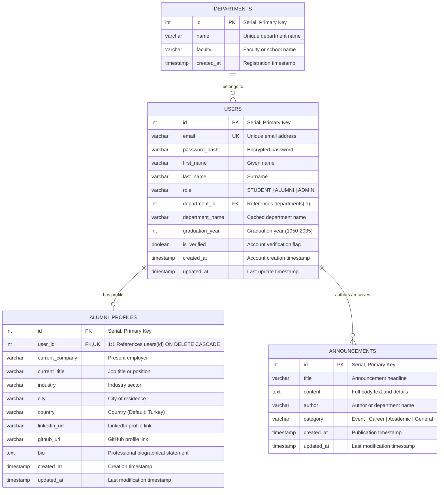

# Data Design Documentation (DDD)
## Alumni Tracking System (Mezun Takip Sistemi)

[](https://www.postgresql.org/)
[](#)
[](#-the-forgetting-test-data-persistence-verification)
[](#)

---

## 📌 1. Executive Summary & Purpose

The **Alumni Tracking System** maintains comprehensive academic, professional, and engagement records for university graduates, current students, and faculty administration. This **Data Design Document (DDD)** defines the conceptual, logical, and physical data structures, relational schemas, normalization rationale, indexing strategies, and containerized persistence protocols for the project.

---

## 🏛️ 2. Conceptual Data Model

The domain model revolves around four core business entities:

1. **Departments (`departments`)**: Represents academic departments and faculties under the university.
2. **Users (`users`)**: Represents registered system actors categorized into `STUDENT`, `ALUMNI`, or `ADMIN`.
3. **Alumni Profiles (`alumni_profiles`)**: Detailed career, employment, and biographical information linked 1:1 to an alumnus.
4. **Announcements (`announcements`)**: Broadcasted university notices, homecoming events, and career opportunities published for alumni.

---

## 📊 3. Entity-Relationship Diagram (ERD)



---

## 📋 4. Relational Data Dictionary (Veri Sözlüğü)

### 4.1. Table: `departments`
Stores academic department hierarchies.

| Column Name | Data Type | Constraints | Description |
|---|---|---|---|
| `id` | `SERIAL` | `PRIMARY KEY` | Auto-incrementing unique department identifier |
| `name` | `VARCHAR(120)` | `NOT NULL, UNIQUE` | Name of the academic department |
| `faculty` | `VARCHAR(120)` | `NOT NULL` | Faculty to which the department belongs |
| `created_at` | `TIMESTAMPTZ` | `DEFAULT CURRENT_TIMESTAMP` | Record creation timestamp |

### 4.2. Table: `users`
Core user entity managing identity, roles, and academic status.

| Column Name | Data Type | Constraints | Description |
|---|---|---|---|
| `id` | `SERIAL` | `PRIMARY KEY` | Auto-incrementing unique user identifier |
| `email` | `VARCHAR(160)` | `NOT NULL, UNIQUE` | User's unique email address |
| `password_hash` | `VARCHAR(255)` | `NULLABLE` | Bcrypt/Argon2 password hash |
| `first_name` | `VARCHAR(80)` | `NOT NULL` | User's first name |
| `last_name` | `VARCHAR(80)` | `NOT NULL` | User's last name |
| `role` | `VARCHAR(20)` | `NOT NULL, DEFAULT 'ALUMNI', CHECK IN ('STUDENT','ALUMNI','ADMIN')` | Authorization role |
| `department_id` | `INT` | `FK -> departments(id) ON DELETE SET NULL` | Linked department reference |
| `department_name` | `VARCHAR(120)` | `NULLABLE` | Cached department name for read performance |
| `graduation_year` | `INT` | `CHECK (graduation_year BETWEEN 1950 AND 2035)` | Academic graduation year |
| `is_verified` | `BOOLEAN` | `DEFAULT TRUE` | Verification flag |
| `created_at` | `TIMESTAMPTZ` | `DEFAULT CURRENT_TIMESTAMP` | Creation timestamp |
| `updated_at` | `TIMESTAMPTZ` | `DEFAULT CURRENT_TIMESTAMP` | Last updated timestamp |

### 4.3. Table: `alumni_profiles`
Extended graduate profile details (1-to-1 relationship with `users`).

| Column Name | Data Type | Constraints | Description |
|---|---|---|---|
| `id` | `SERIAL` | `PRIMARY KEY` | Auto-incrementing identifier |
| `user_id` | `INT` | `NOT NULL, UNIQUE, FK -> users(id) ON DELETE CASCADE` | 1:1 foreign key to users |
| `current_company` | `VARCHAR(120)` | `NULLABLE` | Current employer name |
| `current_title` | `VARCHAR(120)` | `NULLABLE` | Professional job title |
| `industry` | `VARCHAR(80)` | `NULLABLE` | Industry domain |
| `city` | `VARCHAR(80)` | `NULLABLE` | City of residence |
| `country` | `VARCHAR(80)` | `DEFAULT 'Turkey'` | Country of residence |
| `linkedin_url` | `VARCHAR(255)` | `NULLABLE` | LinkedIn profile URL |
| `github_url` | `VARCHAR(255)` | `NULLABLE` | GitHub profile URL |
| `bio` | `TEXT` | `NULLABLE` | Personal bio and statement |
| `created_at` | `TIMESTAMPTZ` | `DEFAULT CURRENT_TIMESTAMP` | Record creation timestamp |
| `updated_at` | `TIMESTAMPTZ` | `DEFAULT CURRENT_TIMESTAMP` | Last updated timestamp |

### 4.4. Table: `announcements`
Broadcasted university and alumni community notices.

| Column Name | Data Type | Constraints | Description |
|---|---|---|---|
| `id` | `SERIAL` | `PRIMARY KEY` | Auto-incrementing identifier |
| `title` | `VARCHAR(200)` | `NOT NULL` | Announcement title |
| `content` | `TEXT` | `NOT NULL` | Full announcement text |
| `author` | `VARCHAR(100)` | `NOT NULL, DEFAULT 'Alumni Administration'` | Publisher identity |
| `category` | `VARCHAR(50)` | `NOT NULL, CHECK IN ('Event', 'Career', 'Academic', 'General')` | Announcement category |
| `created_at` | `TIMESTAMPTZ` | `DEFAULT CURRENT_TIMESTAMP` | Creation timestamp |
| `updated_at` | `TIMESTAMPTZ` | `DEFAULT CURRENT_TIMESTAMP` | Last updated timestamp |

---

## 📐 5. Normalization Analysis

The schema satisfies Third Normal Form (3NF):

1. **First Normal Form (1NF)**:
   - All attributes contain only atomic, scalar values (no multi-valued lists or nested tables).
   - Each table has a defined primary key (`id`).
2. **Second Normal Form (2NF)**:
   - All tables are in 1NF and utilize single-column surrogate primary keys (`SERIAL`).
   - Every non-key attribute is fully functionally dependent on the primary key, eliminating partial dependencies.
3. **Third Normal Form (3NF)**:
   - Department information is decoupled into `departments` rather than storing faculty details directly in `users`, eliminating transitive dependencies (`user_id -> department_id -> faculty`).
   - Profile information is normalized into `alumni_profiles` so that student records are not burdened with sparse alumni employment fields.

---

## ⚡ 6. Indexing & Optimization Strategy

Indexes are applied to columns subject to frequent filtering, sorting, or uniqueness enforcement:

```sql
-- Uniqueness & lookup on user emails
CREATE INDEX idx_users_email ON users(email);

-- Fast filtering by role (STUDENT, ALUMNI, ADMIN)
CREATE INDEX idx_users_role ON users(role);

-- Filtering and sorting by graduation year
CREATE INDEX idx_users_grad_year ON users(graduation_year);

-- Category filtering for announcements
CREATE INDEX idx_announcements_category ON announcements(category);

-- Chronological sorting for announcements feed
CREATE INDEX idx_announcements_created_at ON announcements(created_at DESC);
```

---

## 💾 7. Storage & Containerization Architecture

The system supports two complementary data layer paradigms:
1. **In-Memory Store (`src/models/`)**: High-performance, zero-dependency model layer providing full CRUD operations for unit testing, rapid development, and lightweight execution.
2. **PostgreSQL 16 Database**: Production-ready relational storage initialized via [`db/init.sql`](file:///c:/Users/BusraSeyma/Documents/GitHub/alumni/db/init.sql) with full relational constraints and foreign keys.

---

## 🧪 8. The Forgetting Test (Data Persistence Verification)

### 8.1. What is "The Forgetting Test"?

In containerized environments (Docker), container filesystems are **ephemeral** by default. When a container is removed via `docker compose down`, any records written to the container's temporary writable layer are completely obliterated. The database **"forgets"** the data.

To make the database **"remember"**, a persistent storage mechanism such as a **Docker Named Volume** must be configured. 

**"The Forgetting Test"** is the empirical benchmark verifying that:
1. A record is inserted into the running container.
2. The container is completely brought down (`docker compose down`).
3. The container is recreated from scratch (`docker compose up -d`).
4. The record is queried again and proven to still exist.

```
+------------------------------------------------------------------------------------+
|                             THE FORGETTING TEST PROTOCOL                           |
+------------------------------------------------------------------------------------+

1. DOCKER COMPOSE UP -D
   [Creates alumni_app & alumni_postgres containers]
   [Mounts named volume: postgres_data -> /var/lib/postgresql/data]
                            |
                            v
2. INSERT TEST RECORD
   INSERT INTO announcements (title, content, author, category)
   VALUES ('Persistence Benchmark #1', 'Testing named volume survival', 'QA', 'Event');
                            |
                            v
3. DOCKER COMPOSE DOWN
   [Kills and deletes all containers and virtual networks]
   [Named Volume 'postgres_data' REMAINS INTACT on host storage]
                            |
                            v
4. DOCKER COMPOSE UP -D
   [Spins up brand-new container instances]
   [Attaches fresh postgres container to existing 'postgres_data' volume]
                            |
                            v
5. VERIFICATION QUERY
   SELECT * FROM announcements WHERE title = 'Persistence Benchmark #1';
                            |
       +--------------------+--------------------+
       |                                         |
[If Record is Found]                      [If Record is Lost]
       v                                         v
✅ SUCCESS: The database                  ❌ FAILURE: The database
REMEMBERS the record!                     FORGOT the record!
(Volume persistence verified)             (Ephemeral storage detected)
```

---

### 8.2. How Named Volumes Prevent "Forgetting"

In [`docker-compose.yml`](file:///c:/Users/BusraSeyma/Documents/GitHub/alumni/docker-compose.yml), the persistent named volume is explicitly declared:

```yaml
services:
  postgres:
    image: postgres:16-alpine
    container_name: alumni_postgres
    volumes:
      # Named volume attached to PostgreSQL internal data directory
      - postgres_data:/var/lib/postgresql/data
      - ./db/init.sql:/docker-entrypoint-initdb.d/init.sql:ro

volumes:
  postgres_data:
    driver: local
```

- When `docker compose down` executes, containers and networks are deleted, but named volumes declared in `volumes:` are **retained on host disk**.
- When `docker compose up -d` is subsequently run, the PostgreSQL daemon reads the existing catalog files from `/var/lib/postgresql/data` rather than reinitializing an empty cluster.

---

### 8.3. Step-by-Step Manual Reproduction Guide

#### Step 1: Start the services
```bash
docker compose up -d
```

#### Step 2: Insert a test record
```bash
docker exec -i alumni_postgres psql -U alumni_user -d alumni_db -c \
  "INSERT INTO announcements (title, content, author, category) VALUES ('Homecoming Gala 2026', 'Persistence Test Record', 'Alumni Office', 'Event');"
```

#### Step 3: Verify the record exists before teardown
```bash
docker exec -i alumni_postgres psql -U alumni_user -d alumni_db -c \
  "SELECT id, title, category, created_at FROM announcements WHERE title = 'Homecoming Gala 2026';"
```

*Expected Output:*
```text
 id |         title          | category |          created_at           
----+------------------------+----------+-------------------------------
  4 | Homecoming Gala 2026   | Event    | 2026-10-14 10:30:00.000000+00
(1 row)
```

#### Step 4: Tear down containers (`docker compose down`)
```bash
docker compose down
```

*Output:*
```text
[+] Running 3/3
 ✔ Container alumni_app         Removed
 ✔ Container alumni_postgres    Removed
 ✔ Network alumni_alumni_net    Removed
```

#### Step 5: Re-launch containers (`docker compose up -d`)
```bash
docker compose up -d
```

*Output:*
```text
[+] Running 3/3
 ✔ Network alumni_alumni_net    Created
 ✔ Container alumni_postgres    Started
 ✔ Container alumni_app         Started
```

#### Step 6: Query for the record (The Verification)
```bash
docker exec -i alumni_postgres psql -U alumni_user -d alumni_db -c \
  "SELECT id, title, author, category, created_at FROM announcements WHERE title = 'Homecoming Gala 2026';"
```

*Verification Result:*
```text
 id |         title          |     author      | category |          created_at           
----+------------------------+-----------------+----------+-------------------------------
  4 | Homecoming Gala 2026   | Alumni Office   | Event    | 2026-10-14 10:30:00.000000+00
(1 row)
```

🎉 **Result**: The record survived complete container destruction and re-creation. **The system passed The Forgetting Test!**

---

### 8.4. Automated Test Scripts

Automated scripts are available in the repository:
- **Bash (Linux/macOS)**: [`scripts/forgetting_test.sh`](file:///c:/Users/BusraSeyma/Documents/GitHub/alumni/scripts/forgetting_test.sh)
  ```bash
  chmod +x scripts/forgetting_test.sh
  ./scripts/forgetting_test.sh
  ```
- **PowerShell (Windows)**: [`scripts/forgetting_test.ps1`](file:///c:/Users/BusraSeyma/Documents/GitHub/alumni/scripts/forgetting_test.ps1)
  ```powershell
  powershell -ExecutionPolicy Bypass -File scripts/forgetting_test.ps1
  ```
