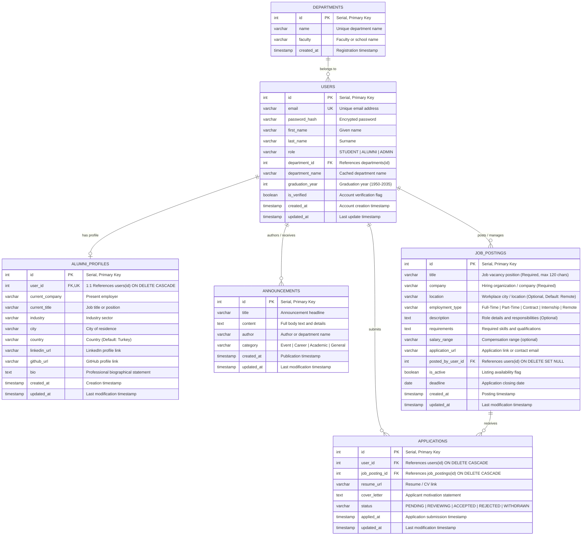
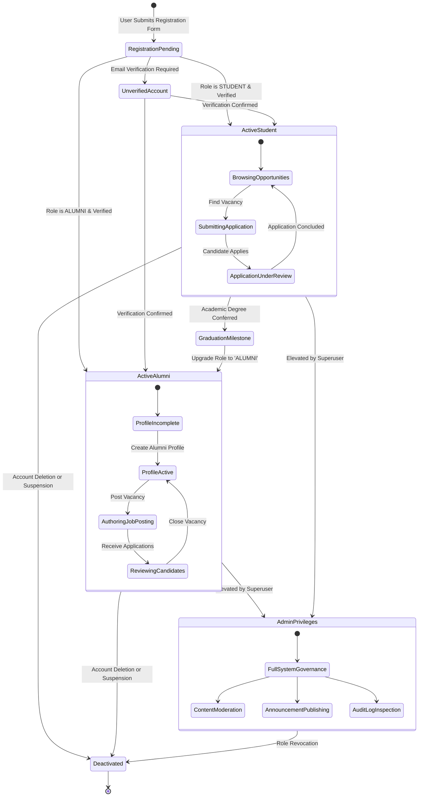
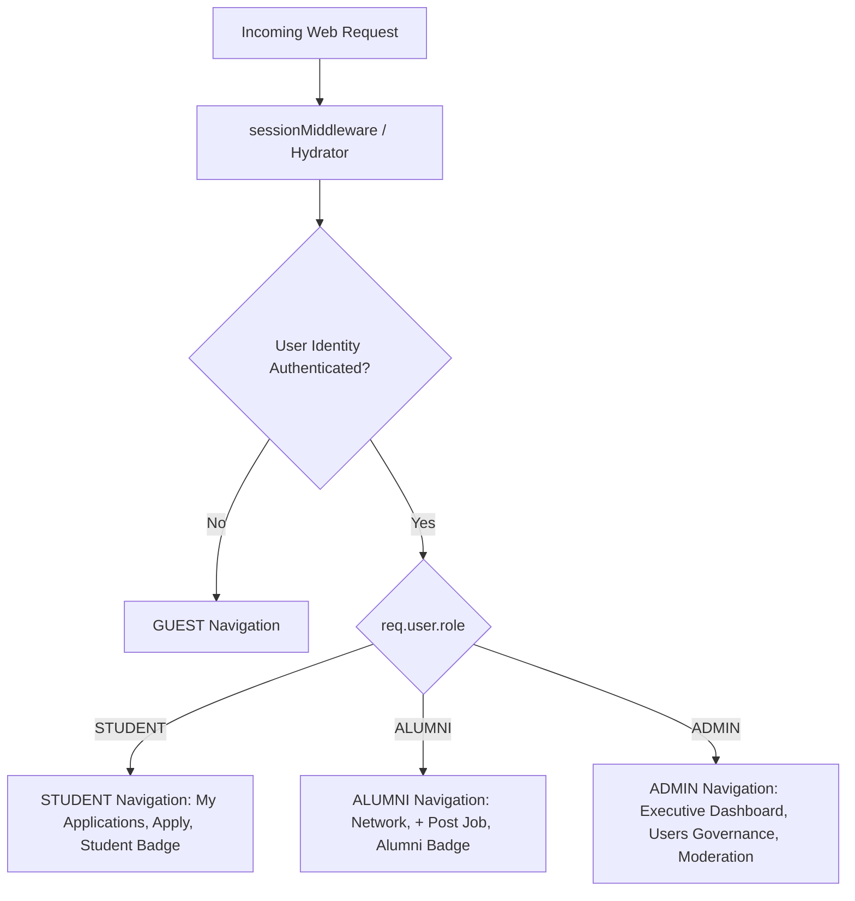

# Data Design Documentation (DDD)
## Alumni Tracking System (Mezun Takip Sistemi)

[](https://www.postgresql.org/)
[](#)
[](#-the-forgetting-test-data-persistence-verification)
[](#)

---

## 📌 1. Executive Summary & Purpose

The **Alumni Tracking System** maintains comprehensive academic, professional, and engagement records for university graduates, current students, and faculty administration. This **Data Design Document (DDD)** defines the conceptual, logical, and physical data structures, relational schemas, normalization rationale, indexing strategies, and containerized persistence protocols for the project.

---

## 🏛️ 2. Conceptual Data Model

The domain model revolves around six core business entities:

1. **Departments (`departments`)**: Represents academic departments and faculties under the university.
2. **Users (`users`)**: Represents registered system actors governed by a 3-tier Role-Based Access Control (RBAC) model: **`STUDENT`** (enrolled students seeking careers/mentorship), **`ALUMNI`** (verified graduates offering jobs/profiles), and **`ADMIN`** (career center superuser governance). *(See [Section 4.2.1](#421-system-actor-roles--personas-sistem-rolleri-ve-aktör-sorumlulukları) for exhaustive personas, RBAC permission matrix, and lifecycle rules)*.
3. **Alumni Profiles (`alumni_profiles`)**: Detailed career, employment, and biographical information linked 1:1 to an alumnus.
4. **Announcements (`announcements`)**: Broadcasted university notices, homecoming events, and campus updates published for alumni.
5. **Job Postings (`job_postings`)**: Career opportunities, internships, and job openings posted by alumni and administrators to connect graduates and students with employment prospects.
6. **Applications (`applications`)**: Action / associative entity resolving the **Many-to-Many (N:M)** relationship between `users` (applicants) and `job_postings` (career opportunities). Records application submissions, resumes, cover letters, and recruitment statuses.

---

## 📊 3. Entity-Relationship Diagram (ERD)



---

## 📋 4. Relational Data Dictionary (Veri Sözlüğü)

### 4.1. Table: `departments`
Stores academic department hierarchies.

| Column Name | Data Type | Constraints | Description |
|---|---|---|---|
| `id` | `SERIAL` | `PRIMARY KEY` | Auto-incrementing unique department identifier |
| `name` | `VARCHAR(120)` | `NOT NULL, UNIQUE` | Name of the academic department |
| `faculty` | `VARCHAR(120)` | `NOT NULL` | Faculty to which the department belongs |
| `created_at` | `TIMESTAMPTZ` | `DEFAULT CURRENT_TIMESTAMP` | Record creation timestamp |

### 4.2. Table: `users`
Core user entity managing identity, roles, and academic status.

| Column Name | Data Type | Constraints | Description |
|---|---|---|---|
| `id` | `SERIAL` | `PRIMARY KEY` | Auto-incrementing unique user identifier |
| `email` | `VARCHAR(160)` | `NOT NULL, UNIQUE` | User's unique email address |
| `password_hash` | `VARCHAR(255)` | `NULLABLE` | Bcrypt/Argon2 password hash |
| `first_name` | `VARCHAR(80)` | `NOT NULL` | User's first name |
| `last_name` | `VARCHAR(80)` | `NOT NULL` | User's last name |
| `role` | `VARCHAR(20)` | `NOT NULL, DEFAULT 'ALUMNI', CHECK IN ('STUDENT','ALUMNI','ADMIN')` | Authorization role |
| `department_id` | `INT` | `FK -> departments(id) ON DELETE SET NULL` | Linked department reference |
| `department_name` | `VARCHAR(120)` | `NULLABLE` | Cached department name for read performance |
| `graduation_year` | `INT` | `CHECK (graduation_year BETWEEN 1950 AND 2035)` | Academic graduation year |
| `is_verified` | `BOOLEAN` | `DEFAULT TRUE` | Verification flag |
| `created_at` | `TIMESTAMPTZ` | `DEFAULT CURRENT_TIMESTAMP` | Creation timestamp |
| `updated_at` | `TIMESTAMPTZ` | `DEFAULT CURRENT_TIMESTAMP` | Last updated timestamp |

#### 4.2.1. System Actor Roles & Personas (Sistem Rolleri ve Aktör Sorumlulukları)

The system enforces a strict 3-tier Role-Based Access Control (RBAC) model defining distinct system personas:

1. **`STUDENT` (Öğrenci - Enrolled Undergraduate / Graduate Student)**:
   - **Primary Objective**: Career preparation, exploring verified graduate networks, seeking mentorship, and applying to internships and entry-level positions.
   - **Core Capabilities**:
     - View verified alumni directory, graduate profiles, and academic departments.
     - Browse, search, and filter active job postings and internship listings (`job_postings`).
     - Submit applications (`applications`) with CV link and personalized cover letter.
     - Track, monitor, and withdraw (`WITHDRAWN`) submitted applications.
     - Read university broadcasts and career announcements (`announcements`).
     - Manage personal contact details and academic status.
   - **Domain Restrictions**: Cannot publish job postings, post public announcements, modify academic departments, or access administrative audit logs. Not eligible to create an `alumni_profiles` record until graduation status is attained.

2. **`ALUMNI` (Mezun - Verified University Graduate)**:
   - **Primary Objective**: Lifelong networking, peer connection, mentoring enrolled students, and offering employment/internship opportunities within their organizations.
   - **Core Capabilities**:
     - Inherits all read and application capabilities of the `STUDENT` role.
     - **Profile Ownership**: Manage a dedicated **Alumni Profile (`alumni_profiles`)** containing current employer, job title, industry classification, city, country, LinkedIn/GitHub links, and biographical statement.
     - **Recruitment & Job Posting**: Author and publish new job vacancies (`job_postings`) on behalf of their company or hiring team.
     - **Application Evaluation**: Review incoming candidate applications submitted to their own job postings, inspect resumes/cover letters, and transition candidate statuses (`PENDING` → `REVIEWING` → `ACCEPTED` / `REJECTED`).
     - Update or close (`is_active = false`) their own job postings.
   - **Domain Restrictions**: Cannot modify or delete job listings or candidate applications belonging to other alumni. Cannot manage university departments or issue institutional announcements.

3. **`ADMIN` (Yönetici - Career Center & System Administrator)**:
   - **Primary Objective**: Institutional oversight, platform governance, academic data integrity, user verification, and community communication.
   - **Core Capabilities**:
     - **Superuser Access**: Unrestricted CRUD permissions across all system entities (`departments`, `users`, `alumni_profiles`, `job_postings`, `applications`, `announcements`).
     - **Role Governance**: Elevate or reassign user roles (`STUDENT` ↔ `ALUMNI` ↔ `ADMIN`).
     - **Account Verification**: Toggle user verification flags (`is_verified = true/false`) and approve alumni registrations.
     - **Content Moderation**: Moderate or remove inappropriate job postings, applications, or profile contents.
     - **Institutional Announcements**: Author, edit, categorize (`Event`, `Career`, `Academic`, `General`), and delete broadcast announcements.
     - **System Auditing**: Access error logs (`logs/error.log`), request metrics, and database lifecycle tools.

---

#### 4.2.2. Role-Based Access Control (RBAC) Permission Matrix

The following matrix formally specifies CRUD (`Create`, `Read`, `Update`, `Delete`) authorization rules per role across every domain entity:

| Domain Entity | Operation | `STUDENT` | `ALUMNI` | `ADMIN` | Authorization Constraints & Business Logic |
|---|---|:---:|:---:|:---:|---|
| **`departments`** | Read | ✅ | ✅ | ✅ | Publicly visible to all authenticated and visiting actors |
| | Create / Update / Delete | ❌ | ❌ | ✅ | Restricted exclusively to institutional administrators |
| **`users`** | Read Directory | ✅ | ✅ | ✅ | Publicly visible graduate & student directory |
| | Create (Register) | ✅ | ✅ | ✅ | Open self-registration or batch administrative seeding |
| | Update Profile | 🔒 Own | 🔒 Own | ✅ Any | Users can update their own data; Admin can update any user and change roles |
| | Delete User | ❌ | ❌ | ✅ | Hard or soft deletion reserved for administrative governance |
| **`alumni_profiles`** | Read | ✅ | ✅ | ✅ | Full visibility across network |
| | Create / Update | ❌ | 🔒 Own | ✅ Any | Only verified alumni can author their 1:1 career profile |
| | Delete | ❌ | 🔒 Own | ✅ Any | Profile reset or deletion |
| **`job_postings`** | Read (Active) | ✅ | ✅ | ✅ | All users can discover published career listings |
| | Create | ❌ | ✅ | ✅ | Verified alumni and admins can publish vacancies |
| | Update / Close | ❌ | 🔒 Own | ✅ Any | Posters can edit/close own listings; Admin can moderate any listing |
| | Delete | ❌ | 🔒 Own | ✅ Any | Hard delete by posting owner or admin |
| **`applications`** | Submit (Create) | ✅ | ✅ | ✅ | Candidates can submit at most 1 application per vacancy (`UNIQUE(user_id, job_posting_id)`) |
| | Read Own Applications | 🔒 Own | 🔒 Own | ✅ Any | Candidates can view their own application history |
| | Read Received Applications | ❌ | 🔒 Posted Jobs | ✅ Any | Job posters can inspect candidates applying to their postings |
| | Update Status | ❌ | 🔒 Posted Jobs | ✅ Any | Posters update status (`REVIEWING`, `ACCEPTED`, `REJECTED`) |
| | Withdraw Application | 🔒 Own | 🔒 Own | ✅ Any | Applicant can withdraw pending application (`WITHDRAWN`) |
| **`announcements`** | Read | ✅ | ✅ | ✅ | Broadcast feed visible to all platform actors |
| | Create / Update / Delete | ❌ | ❌ | ✅ | Institutional notice publishing reserved for Admin |
| **`logs & system`** | Read / Manage | ❌ | ❌ | ✅ | Server logs (`logs/error.log`) and migration tools reserved for Admin |

---

#### 4.2.3. User Domain Validation & Business Rules

* **Email Specification (`email`)**:
  - **Required** (`NOT NULL`), strictly validated against RFC 5322 regex: `^[^\s@]+@[^\s@]+\.[^\s@]+$`.
  - Normalized to lowercase upon persistence (`LOWER(email)`).
  - Enforced by a system-wide database unique constraint (`UNIQUE`). Duplicate submission triggers `409 Conflict`.
* **Role Integrity (`role`)**:
  - Constrained by database check: `CHECK (role IN ('STUDENT', 'ALUMNI', 'ADMIN'))`.
  - Default value is `'ALUMNI'`.
  - Invalid role payload automatically rejected with `400 Bad Request`.
* **Name Fields (`first_name`, `last_name`)**:
  - **Required** (`NOT NULL`), maximum 80 characters.
  - Automatically trimmed of leading and trailing whitespace.
* **Graduation Year Semantics (`graduation_year`)**:
  - Bounded by check constraint: `CHECK (graduation_year BETWEEN 1950 AND 2035)`.
  - **For `ALUMNI`**: Represents historical graduation year ($\le \text{Current Academic Year}$).
  - **For `STUDENT`**: Represents expected future completion year ($\ge \text{Current Academic Year}$).
* **Account Verification (`is_verified`)**:
  - Boolean flag indicating credential verification or email ownership confirmation.
  - Defaults to `TRUE` (in test/seeder environments) and togglable by administrators.
* **Referential Integrity & Cascading Policies**:
  - `departments` deletion &rarr; sets `users.department_id` to `NULL` (`ON DELETE SET NULL`), while cached `department_name` preserves historical continuity.
  - `users` deletion &rarr; cascades deletion to linked `alumni_profiles` (`ON DELETE CASCADE`) and candidate `applications` (`ON DELETE CASCADE`).
  - `users` deletion &rarr; updates authored `job_postings.posted_by_user_id` to `NULL` (`ON DELETE SET NULL`) so open recruitment opportunities remain available to applicants without causing broken foreign keys.

---

#### 4.2.4. User Lifecycle & State Machine

The following state diagram illustrates user progression through registration, role activation, academic graduation, and administrative governance:



### 4.3. Table: `alumni_profiles`
Extended graduate profile details (1-to-1 relationship with `users`).

| Column Name | Data Type | Constraints | Description |
|---|---|---|---|
| `id` | `SERIAL` | `PRIMARY KEY` | Auto-incrementing identifier |
| `user_id` | `INT` | `NOT NULL, UNIQUE, FK -> users(id) ON DELETE CASCADE` | 1:1 foreign key to users |
| `current_company` | `VARCHAR(120)` | `NULLABLE` | Current employer name |
| `current_title` | `VARCHAR(120)` | `NULLABLE` | Professional job title |
| `industry` | `VARCHAR(80)` | `NULLABLE` | Industry domain |
| `city` | `VARCHAR(80)` | `NULLABLE` | City of residence |
| `country` | `VARCHAR(80)` | `DEFAULT 'Turkey'` | Country of residence |
| `linkedin_url` | `VARCHAR(255)` | `NULLABLE` | LinkedIn profile URL |
| `github_url` | `VARCHAR(255)` | `NULLABLE` | GitHub profile URL |
| `bio` | `TEXT` | `NULLABLE` | Personal bio and statement |
| `created_at` | `TIMESTAMPTZ` | `DEFAULT CURRENT_TIMESTAMP` | Record creation timestamp |
| `updated_at` | `TIMESTAMPTZ` | `DEFAULT CURRENT_TIMESTAMP` | Last updated timestamp |

### 4.4. Table: `announcements`
Broadcasted university and alumni community notices.

| Column Name | Data Type | Constraints | Description |
|---|---|---|---|
| `id` | `SERIAL` | `PRIMARY KEY` | Auto-incrementing identifier |
| `title` | `VARCHAR(200)` | `NOT NULL` | Announcement title |
| `content` | `TEXT` | `NOT NULL` | Full announcement text |
| `author` | `VARCHAR(100)` | `NOT NULL, DEFAULT 'Alumni Administration'` | Publisher identity |
| `category` | `VARCHAR(50)` | `NOT NULL, CHECK IN ('Event', 'Career', 'Academic', 'General')` | Announcement category |
| `created_at` | `TIMESTAMPTZ` | `DEFAULT CURRENT_TIMESTAMP` | Creation timestamp |
| `updated_at` | `TIMESTAMPTZ` | `DEFAULT CURRENT_TIMESTAMP` | Last updated timestamp |

### 4.5. Table: `job_postings`
Career, internship, and employment postings published by alumni and administration.

| Column Name | Data Type | Constraints | Description |
|---|---|---|---|
| `id` | `SERIAL` | `PRIMARY KEY` | Auto-incrementing unique job posting identifier |
| `title` | `VARCHAR(120)` | `NOT NULL` | Job vacancy position / title (**Required**, maximum **120 characters**) |
| `company` | `VARCHAR(120)` | `NOT NULL` | Hiring organization / company name (**Required**) |
| `location` / `city` | `VARCHAR(100)` | `NULLABLE, DEFAULT 'Remote'` | Workplace city or location (**Optional**, e.g., "Istanbul", "Remote") |
| `employment_type` | `VARCHAR(30)` | `NOT NULL, DEFAULT 'Full-Time', CHECK IN ('Full-Time', 'Part-Time', 'Contract', 'Internship', 'Remote')` | Employment classification |
| `description` | `TEXT` | `NULLABLE` | Comprehensive job overview, responsibilities, and team info (**Optional**) |
| `requirements` | `TEXT` | `NULLABLE` | Required technical qualifications, experience, and skills |
| `salary_range` | `VARCHAR(80)` | `NULLABLE` | Disclosed compensation or salary band (e.g., "$80,000 - $110,000") |
| `application_url` | `VARCHAR(255)` | `NULLABLE` | Application portal URL or recruiter contact email |
| `posted_by_user_id` | `INT` | `FK -> users(id) ON DELETE SET NULL` | Alumnus or admin who published the opportunity |
| `is_active` | `BOOLEAN` | `DEFAULT TRUE` | Posting visibility flag (true = open, false = closed) |
| `deadline` | `DATE` | `NULLABLE` | Application cutoff date |
| `created_at` | `TIMESTAMPTZ` | `DEFAULT CURRENT_TIMESTAMP` | Record creation timestamp |
| `updated_at` | `TIMESTAMPTZ` | `DEFAULT CURRENT_TIMESTAMP` | Last modification timestamp |

#### 📋 Job Posting Domain & Business Rules
* **Title (`title`)**: **Required**. String value. Strictly capped at **maximum 120 characters**. Submissions exceeding 120 characters or with empty values trigger `400 Bad Request`.
* **Company (`company`)**: **Required**. Name of hiring company or institution. Cannot be blank or empty (`400 Bad Request` if omitted).
* **City / Location (`city` / `location`)**: **Optional**. Can be omitted, specified as a city name (e.g. `Ankara`, `Izmir`), or marked as `Remote`.
* **Description (`description`)**: **Optional**. Narrative details of the role are optional upon vacancy registration and can be populated or enriched incrementally.

### 4.6. Table: `applications` (Action / Associative Table)
Resolves the **Many-to-Many (N:M)** relationship between `users` (applicants) and `job_postings` (vacancies). Tracks candidate submissions, cover letters, and recruitment stages.

| Column Name | Data Type | Constraints | Description |
|---|---|---|---|
| `id` | `SERIAL` | `PRIMARY KEY` | Auto-incrementing unique application identifier |
| `user_id` | `INT` | `NOT NULL, FK -> users(id) ON DELETE CASCADE` | Applicant identifier |
| `job_posting_id` | `INT` | `NOT NULL, FK -> job_postings(id) ON DELETE CASCADE` | Job vacancy identifier |
| `resume_url` | `VARCHAR(255)` | `NULLABLE` | URL link to applicant's CV / resume file or portfolio |
| `cover_letter` | `TEXT` | `NULLABLE` | Applicant motivation statement and introduction |
| `status` | `VARCHAR(30)` | `NOT NULL, DEFAULT 'PENDING', CHECK IN ('PENDING', 'REVIEWING', 'ACCEPTED', 'REJECTED', 'WITHDRAWN')` | Recruitment pipeline status |
| `applied_at` | `TIMESTAMPTZ` | `DEFAULT CURRENT_TIMESTAMP` | Initial application submission timestamp |
| `updated_at` | `TIMESTAMPTZ` | `DEFAULT CURRENT_TIMESTAMP` | Status change or modification timestamp |

> 🔒 **Composite Unique Constraint:** `UNIQUE(user_id, job_posting_id)` prevents candidate spam by ensuring a user can submit at most one active application per job posting.

---

## 📐 5. Normalization Analysis

The schema satisfies Third Normal Form (3NF):

1. **First Normal Form (1NF)**:
   - All attributes contain only atomic, scalar values (no multi-valued lists or nested tables).
   - Each table has a defined primary key (`id`).
2. **Second Normal Form (2NF)**:
   - All tables are in 1NF and utilize single-column surrogate primary keys (`SERIAL`).
   - Every non-key attribute is fully functionally dependent on the primary key, eliminating partial dependencies.
3. **Third Normal Form (3NF) & Many-to-Many Decomposition**:
   - Department information is decoupled into `departments` rather than storing faculty details directly in `users`, eliminating transitive dependencies (`user_id -> department_id -> faculty`).
   - Profile information is normalized into `alumni_profiles` so that student records are not burdened with sparse alumni employment fields.
   - Job opportunities are isolated in `job_postings` with a clean foreign key reference (`posted_by_user_id -> users(id)`), eliminating redundant storage of user contact/profile details in the job postings table.
   - The Many-to-Many (N:M) relationship between `users` (applicants) and `job_postings` (career opportunities) is resolved using the action table `applications` (`users 1:N applications` and `job_postings 1:N applications`). This eliminates repeating groups, maintains referential integrity, and enforces 3NF compliance.

---

## ⚡ 6. Indexing & Optimization Strategy

Indexes are applied to columns subject to frequent filtering, sorting, or uniqueness enforcement:

```sql
-- Uniqueness & lookup on user emails
CREATE INDEX idx_users_email ON users(email);

-- Fast filtering by role (STUDENT, ALUMNI, ADMIN)
CREATE INDEX idx_users_role ON users(role);

-- Filtering and sorting by graduation year
CREATE INDEX idx_users_grad_year ON users(graduation_year);

-- Category filtering for announcements
CREATE INDEX idx_announcements_category ON announcements(category);

-- Chronological sorting for announcements feed
CREATE INDEX idx_announcements_created_at ON announcements(created_at DESC);

-- Fast filtering for active job postings
CREATE INDEX idx_job_postings_active ON job_postings(is_active);

-- Fast search and filtering by employment type (Full-Time, Internship, etc.)
CREATE INDEX idx_job_postings_employment_type ON job_postings(employment_type);

-- Lookup of jobs posted by a specific alumnus or admin
CREATE INDEX idx_job_postings_posted_by ON job_postings(posted_by_user_id);

-- Chronological sorting for job board listings (newest first)
CREATE INDEX idx_job_postings_created_at ON job_postings(created_at DESC);

-- Fast lookup of all applications submitted by a user
CREATE INDEX idx_applications_user_id ON applications(user_id);

-- Fast lookup of all candidate applications received for a job posting
CREATE INDEX idx_applications_job_id ON applications(job_posting_id);

-- Fast filtering by application status (PENDING, REVIEWING, ACCEPTED, etc.)
CREATE INDEX idx_applications_status ON applications(status);

-- Prevent duplicate applications and accelerate composite queries
CREATE UNIQUE INDEX idx_applications_user_job ON applications(user_id, job_posting_id);
```

---

## 💾 7. Storage & Containerization Architecture

The system supports two complementary data layer paradigms:
1. **In-Memory Store (`src/models/`)**: High-performance, zero-dependency model layer providing full CRUD operations for unit testing, rapid development, and lightweight execution.
2. **PostgreSQL 16 Database**: Production-ready relational storage initialized via [`db/init.sql`](file:///c:/Users/BusraSeyma/Documents/GitHub/alumni/db/init.sql) with full relational constraints and foreign keys.

---

## 🧪 8. The Forgetting Test (Data Persistence Verification)

### 8.1. What is "The Forgetting Test"?

In containerized environments (Docker), container filesystems are **ephemeral** by default. When a container is removed via `docker compose down`, any records written to the container's temporary writable layer are completely obliterated. The database **"forgets"** the data.

To make the database **"remember"**, a persistent storage mechanism such as a **Docker Named Volume** must be configured. 

**"The Forgetting Test"** is the empirical benchmark verifying that:
1. A record is inserted into the running container.
2. The container is completely brought down (`docker compose down`).
3. The container is recreated from scratch (`docker compose up -d`).
4. The record is queried again and proven to still exist.

```
+------------------------------------------------------------------------------------+
|                             THE FORGETTING TEST PROTOCOL                           |
+------------------------------------------------------------------------------------+

1. DOCKER COMPOSE UP -D
   [Creates alumni_app & alumni_postgres containers]
   [Mounts named volume: postgres_data -> /var/lib/postgresql/data]
                            |
                            v
2. INSERT TEST RECORD
   INSERT INTO announcements (title, content, author, category)
   VALUES ('Persistence Benchmark #1', 'Testing named volume survival', 'QA', 'Event');
                            |
                            v
3. DOCKER COMPOSE DOWN
   [Kills and deletes all containers and virtual networks]
   [Named Volume 'postgres_data' REMAINS INTACT on host storage]
                            |
                            v
4. DOCKER COMPOSE UP -D
   [Spins up brand-new container instances]
   [Attaches fresh postgres container to existing 'postgres_data' volume]
                            |
                            v
5. VERIFICATION QUERY
   SELECT * FROM announcements WHERE title = 'Persistence Benchmark #1';
                            |
       +--------------------+--------------------+
       |                                         |
[If Record is Found]                      [If Record is Lost]
       v                                         v
✅ SUCCESS: The database                  ❌ FAILURE: The database
REMEMBERS the record!                     FORGOT the record!
(Volume persistence verified)             (Ephemeral storage detected)
```

---

### 8.2. How Named Volumes Prevent "Forgetting"

In [`docker-compose.yml`](file:///c:/Users/BusraSeyma/Documents/GitHub/alumni/docker-compose.yml), the persistent named volume is explicitly declared:

```yaml
services:
  postgres:
    image: postgres:16-alpine
    container_name: alumni_postgres
    volumes:
      # Named volume attached to PostgreSQL internal data directory
      - postgres_data:/var/lib/postgresql/data
      - ./db/init.sql:/docker-entrypoint-initdb.d/init.sql:ro

volumes:
  postgres_data:
    driver: local
```

- When `docker compose down` executes, containers and networks are deleted, but named volumes declared in `volumes:` are **retained on host disk**.
- When `docker compose up -d` is subsequently run, the PostgreSQL daemon reads the existing catalog files from `/var/lib/postgresql/data` rather than reinitializing an empty cluster.

---

### 8.3. Step-by-Step Manual Reproduction Guide

#### Step 1: Start the services
```bash
docker compose up -d
```

#### Step 2: Insert a test record
```bash
docker exec -i alumni_postgres psql -U alumni_user -d alumni_db -c \
  "INSERT INTO announcements (title, content, author, category) VALUES ('Homecoming Gala 2026', 'Persistence Test Record', 'Alumni Office', 'Event');"
```

#### Step 3: Verify the record exists before teardown
```bash
docker exec -i alumni_postgres psql -U alumni_user -d alumni_db -c \
  "SELECT id, title, category, created_at FROM announcements WHERE title = 'Homecoming Gala 2026';"
```

*Expected Output:*
```text
 id |         title          | category |          created_at           
----+------------------------+----------+-------------------------------
  4 | Homecoming Gala 2026   | Event    | 2026-10-14 10:30:00.000000+00
(1 row)
```

#### Step 4: Tear down containers (`docker compose down`)
```bash
docker compose down
```

*Output:*
```text
[+] Running 3/3
 ✔ Container alumni_app         Removed
 ✔ Container alumni_postgres    Removed
 ✔ Network alumni_alumni_net    Removed
```

#### Step 5: Re-launch containers (`docker compose up -d`)
```bash
docker compose up -d
```

*Output:*
```text
[+] Running 3/3
 ✔ Network alumni_alumni_net    Created
 ✔ Container alumni_postgres    Started
 ✔ Container alumni_app         Started
```

#### Step 6: Query for the record (The Verification)
```bash
docker exec -i alumni_postgres psql -U alumni_user -d alumni_db -c \
  "SELECT id, title, author, category, created_at FROM announcements WHERE title = 'Homecoming Gala 2026';"
```

*Verification Result:*
```text
 id |         title          |     author      | category |          created_at           
----+------------------------+-----------------+----------+-------------------------------
  4 | Homecoming Gala 2026   | Alumni Office   | Event    | 2026-10-14 10:30:00.000000+00
(1 row)
```

🎉 **Result**: The record survived complete container destruction and re-creation. **The system passed The Forgetting Test!**

---

### 8.4. Automated Test Scripts

Automated scripts are available in the repository:
- **Bash (Linux/macOS)**: [`scripts/forgetting_test.sh`](file:///c:/Users/BusraSeyma/Documents/GitHub/alumni/scripts/forgetting_test.sh)
  ```bash
  chmod +x scripts/forgetting_test.sh
  ./scripts/forgetting_test.sh
  ```
- **PowerShell (Windows)**: [`scripts/forgetting_test.ps1`](file:///c:/Users/BusraSeyma/Documents/GitHub/alumni/scripts/forgetting_test.ps1)
  ```powershell
  powershell -ExecutionPolicy Bypass -File scripts/forgetting_test.ps1
  ```

---

## 🔄 9. Migration Architecture & Database Lifecycle

The system features an automated, transactional migration runner located in [`src/database/migrator.js`](file:///c:/Users/BusraSeyma/Documents/GitHub/alumni/src/database/migrator.js) with dedicated versioned migration files in [`src/database/migrations/`](file:///c:/Users/BusraSeyma/Documents/GitHub/alumni/src/database/migrations/):

### 9.1. Migration Files Structure

| Sequence | Migration File | Target Schema / Table | Operations (Up / Down) |
|---|---|---|---|
| `001` | [`001_create_departments_table.js`](file:///c:/Users/BusraSeyma/Documents/GitHub/alumni/src/database/migrations/001_create_departments_table.js) | `departments` | `CREATE TABLE` / `DROP TABLE CASCADE` |
| `002` | [`002_create_users_table.js`](file:///c:/Users/BusraSeyma/Documents/GitHub/alumni/src/database/migrations/002_create_users_table.js) | `users` | `CREATE TABLE`, Constraints & Indexes / `DROP TABLE CASCADE` |
| `003` | [`003_create_alumni_profiles_table.js`](file:///c:/Users/BusraSeyma/Documents/GitHub/alumni/src/database/migrations/003_create_alumni_profiles_table.js) | `alumni_profiles` | `CREATE TABLE` (1:1 with users) / `DROP TABLE CASCADE` |
| `004` | [`004_create_announcements_table.js`](file:///c:/Users/BusraSeyma/Documents/GitHub/alumni/src/database/migrations/004_create_announcements_table.js) | `announcements` | `CREATE TABLE` & Category Indexes / `DROP TABLE CASCADE` |
| `005` | [`005_create_job_postings_table.js`](file:///c:/Users/BusraSeyma/Documents/GitHub/alumni/src/database/migrations/005_create_job_postings_table.js) | `job_postings` | `CREATE TABLE`, Indexes & Foreign Keys / `DROP TABLE CASCADE` |
| `006` | [`006_create_applications_table.js`](file:///c:/Users/BusraSeyma/Documents/GitHub/alumni/src/database/migrations/006_create_applications_table.js) | `applications` | `CREATE TABLE` (N:M Action Table), Composite Unique Index / `DROP TABLE CASCADE` |

### 9.2. Automated Database Creation & Tracking

- **Database Creation (`createDatabaseIfNotExists`)**: The runner connects to the administrative `postgres` database and automatically creates the target database (`alumni_db`) if it does not yet exist.
- **Migration Tracking (`migrations` table)**:
  ```sql
  CREATE TABLE IF NOT EXISTS migrations (
    id SERIAL PRIMARY KEY,
    name VARCHAR(255) NOT NULL UNIQUE,
    executed_at TIMESTAMP WITH TIME ZONE DEFAULT CURRENT_TIMESTAMP
  );
  ```
- **Transaction Safety**: Each migration runs wrapped in a `BEGIN ... COMMIT` block. If any statement fails, the runner triggers a `ROLLBACK` ensuring the database is never left in an inconsistent partial state.

---

## 🏭 10. Factories & Seeders Architecture

### 10.1. Factory Pattern Implementation ([`src/database/factories/`](file:///c:/Users/BusraSeyma/Documents/GitHub/alumni/src/database/factories/))

The Factory pattern dynamically produces valid, realistic mock records with customizable override attributes:

- **`departmentFactory.js`**: Generates faculties and university departments.
- **`userFactory.js`**: Generates realistic Turkish and international names, unique email formats, randomized valid roles (`STUDENT`, `ALUMNI`, `ADMIN`), and graduation years (1950–2035).
- **`alumniProfileFactory.js`**: Generates career companies (Google, Microsoft, Trendyol, Aselsan), job titles, industry tags, LinkedIn/GitHub profile URLs, and bios.
- **`announcementFactory.js`**: Generates broadcast notices with valid categories (`Event`, `Career`, `Academic`, `General`).

### 10.2. Seeders Workflow ([`src/database/seeders/`](file:///c:/Users/BusraSeyma/Documents/GitHub/alumni/src/database/seeders/))

1. **`departmentSeeder.js`**: Populates default academic departments.
2. **`userSeeder.js`**: Seeds core predictable users (`admin@alumni.istanbul.edu.tr`, `emre.yilmaz`, `ayse.kaya`) followed by batch factory-generated users. For alumni users, corresponding `alumni_profiles` entries are generated automatically.
3. **`announcementSeeder.js`**: Seeds official campus announcements followed by factory-generated notices.
4. **`databaseSeeder.js` (Master Seeder)**: Coordinates table truncation (preserving foreign key cascades) and executes all seeders sequentially. If PostgreSQL is offline, gracefully seeds in-memory models.

### 10.3. Database CLI Commands

```bash
# Create database if not exists
npm run db:create

# Run all pending migrations
npm run db:migrate

# Rollback the last migration batch
npm run db:rollback

# Inspect migration execution status
npm run db:status

# Seed database with factory-generated records
npm run db:seed

# Full automated one-step setup (create + migrate + seed)
npm run db:setup
```

---

## 🛡️ 11. Administrative Subsystem & Role Governance (Admin Panel)

### 11.1. Overview & Security Architecture
The **Executive Admin Panel** ([`/admin`](file:///c:/Users/BusraSeyma/Documents/GitHub/alumni/views/admin/index.ejs)) is a high-clearance administrative control surface reserved strictly for the `ADMIN` role. It is shielded by `authMiddleware` and `requireRole('ADMIN')`:
- **Unauthenticated access**: Web requests are redirected to `/login?redirect=/admin`; API requests return structured `401 Unauthorized` with explicit diagnostic reason.
- **Unauthorized role access** (e.g. `STUDENT` or `ALUMNI`): Terminated with structured `403 Forbidden` (`Access denied. Your role 'ALUMNI' does not possess required clearance. Allowed role(s): ADMIN`).

### 11.2. Role Assignment & Elevation Mechanism
1. **Pre-configured Antigravity Superuser Admin**:
   - Identity: `admin@alumni.istanbul.edu.tr` (or `antigravity@alumni.istanbul.edu.tr`)
   - Password: `adminpassword`
   - Superuser ID: `99`, Role: `ADMIN`
2. **One-Click Role Elevation & Claim**:
   - Web: [`/admin/claim`](file:///c:/Users/BusraSeyma/Documents/GitHub/alumni/views/admin/claim.ejs) allows any user or developer to immediately elevate their active session to `ADMIN` or authenticate as Antigravity Admin with refreshed cryptographic session tokens.
   - API: `POST /api/admin/claim` provides zero-friction admin token provisioning for automated CI/CD and CLI workflows.

### 11.3. Cross-Domain Data Manipulation
| Target Domain Entity | Administrative Capabilities | Web Form Route | Programmatic REST API |
|---|---|---|---|
| **Users** | Role Elevation (`STUDENT` / `ALUMNI` / `ADMIN`), Toggle `is_verified`, Delete User | `POST /admin/users/:id/role`<br>`POST /admin/users/:id/toggle-verify`<br>`POST /admin/users/:id/delete` | `PATCH /api/admin/users/:id/role`<br>`PATCH /api/admin/users/:id/verify`<br>`DELETE /api/admin/users/:id` |
| **Job Postings** | Toggle Active Status (`is_active` true/false), Delete Listing | `POST /admin/jobs/:id/toggle-status`<br>`POST /admin/jobs/:id/delete` | `PATCH /api/admin/jobs/:id/status`<br>`DELETE /api/admin/jobs/:id` |
| **Applications** | Recruitment Pipeline Transition (`PENDING`, `REVIEWING`, `ACCEPTED`, `REJECTED`, `WITHDRAWN`), Delete Submission | `POST /admin/applications/:id/status`<br>`POST /admin/applications/:id/delete` | `PATCH /api/admin/applications/:id/status`<br>`DELETE /api/admin/applications/:id` |
| **Announcements** | Publish Campus Broadcast, Delete Announcement | `POST /admin/announcements`<br>`POST /admin/announcements/:id/delete` | `POST /api/announcements`<br>`DELETE /api/announcements/:id` |
| **Telemetry** | Cross-Entity Telemetry Aggregation & Real-time Metrics | `GET /admin` | `GET /api/admin/stats` |

---

## 🧭 12. Dynamic Role-Based Navigation Architecture

### 12.1. Architectural Overview
The portal's navigation subsystem ([`src/utils/navigation.js`](file:///c:/Users/BusraSeyma/Documents/GitHub/alumni/src/utils/navigation.js) & [`views/partials/header.ejs`](file:///c:/Users/BusraSeyma/Documents/GitHub/alumni/views/partials/header.ejs)) dynamically personalizes menu items, action triggers, and badges based on the user's authenticated role.



### 12.2. Role-Based Navigation Matrix

| Role Tier | Primary Navbar Links | Contextual Quick Action Buttons | User Badge & Controls |
|---|---|---|---|
| **`GUEST`** (Unauthenticated) | Home (`/`), Directory (`/users`), Job Board (`/jobs`), Announcements (`/announcements`), Brand (`/brand`), About (`/about`), Swagger (`/api/swagger`) | `Sign In` (`/login`), `✨ Register` (`/register`), `+ Apply` (`/applications/new`), `🛡️ Admin Claim` (`/admin/claim`) | `Sign In` & `Register` links |
| **`STUDENT`** | Home (`/`), Alumni Directory (`/users`), Job Board (`/jobs`), My Applications (`/applications`), Announcements (`/announcements`), About (`/about`), Swagger (`/api/swagger`) | `✨ + Apply to Job` (`/applications/new`), `⚡ Claim Admin` (`/admin/claim`) | `🎓 STUDENT` badge, `👤 [Name]`, `Sign Out` |
| **`ALUMNI`** | Home (`/`), Alumni Network (`/users`), Job Board (`/jobs`), Applications (`/applications`), Announcements (`/announcements`), About (`/about`), Swagger (`/api/swagger`) | `+ Post Job` (`/jobs/new`), `+ Apply` (`/applications/new`), `⚡ Claim Admin` (`/admin/claim`) | `💼 ALUMNI` badge, `👤 [Name]`, `Sign Out` |
| **`ADMIN`** | `🛡️ Dashboard` (`/admin`), `Users Governance` (`/admin/users`), `Job Moderation` (`/admin/jobs`), `Candidate Pipeline` (`/admin/applications`), `Broadcasts` (`/admin/announcements`), `Public Portal` (`/`), `Swagger` (`/api/swagger`) | `🛡️ Admin Panel` (`/admin`), `+ Post Vacancy` (`/jobs/new`), `+ Broadcast` (`/admin/announcements`) | `🛡️ ADMIN` badge, Glowing `🛡️ Admin` pill, `👤 [Name]`, `Sign Out` |


